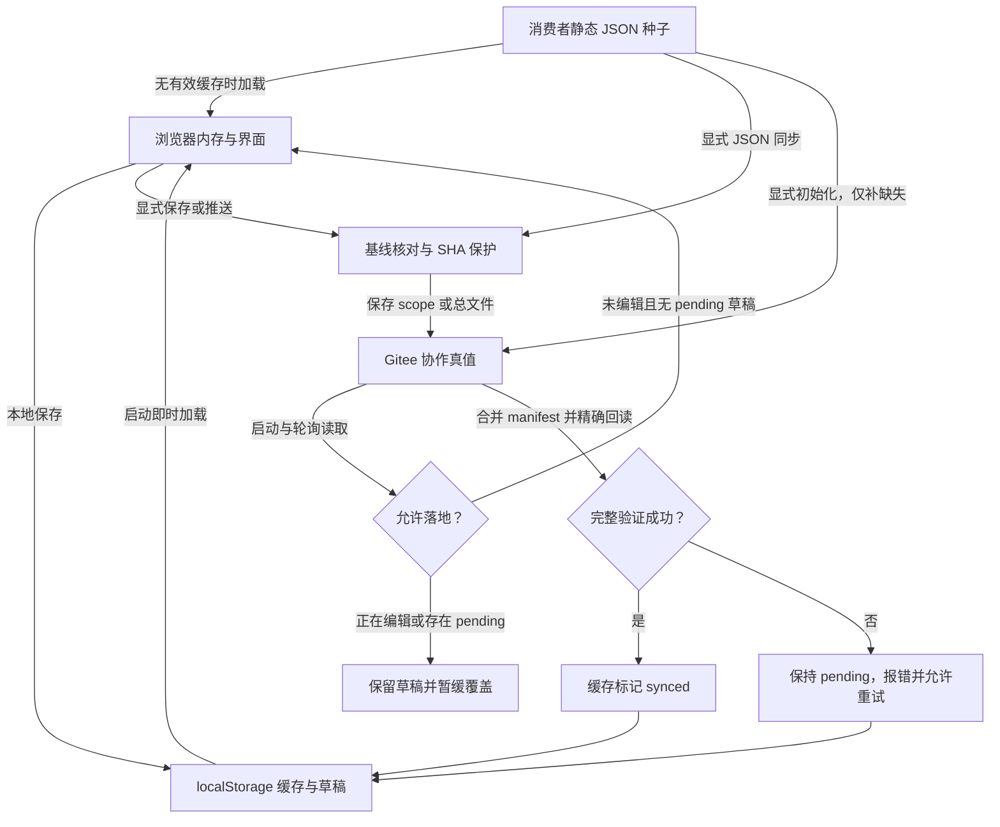

# Prototype Core

面向移动端与 PC Web 产品原型的 Vue 评审内核，提供交互、全图、流程、流程编排、测试用例、主题、i18n、注释、页面描述、健康检查和协作能力。

## 安装

```bash
pnpm add @marktowin/prototype-core vue @lucide/vue
```

消费者新增或替换的常规 UI 图标统一使用 Iconify，默认选用 `lucide` 图标集，另行安装：

```bash
pnpm add @iconify/vue @iconify-icons/lucide
```

图标数据从单图标路径本地导入并随消费者按需打包，不默认在线加载或整库注册；不为常规图标手写 SVG、CSS 或 Canvas，也不使用 Emoji、Unicode 字符替代。品牌 Logo、产品专属插画和业务图表使用提供的素材或专项实现，缺少资源时说明缺口，不自行仿画。内核仍依赖 `@lucide/vue`，不得删除该 peer dependency；不要求迁移历史页面。

安装后的业务组件用法和 `pages[].icon` 的 Vue 组件封装示例见[消费者手册第 6.3.1 节](https://github.com/MarkTina/prototype-core/blob/main/AI-PROTOTYPE-GUIDE.md#631-图标选型与使用)。

## 使用

```ts
import { mountPrototypeApp } from '@marktowin/prototype-core'
import '@marktowin/prototype-core/style.css'
import { product } from './product'

void mountPrototypeApp({
  target: '#app',
  product,
})
```

完整接入方式见 `examples/basic`。默认关闭访问认证并使用本地协作模式；需要云端协作时通过 `runtimeConfig` 显式注入配置。

语言切换只作用于消费者业务 UI 和业务状态文案。消费者继续在 `product.copy.zh/en` 中维护业务文案；注释、页面描述、协作状态、数据源和测试工具等内核界面固定显示中文，消费者不需要也不应配置内核文案。

应用可通过顶部“测试用例”或固定路由 `#/test-cases` 打开工作台。测试用例按页面/状态 scope 管理：有状态页面使用 `<screenId>__<stateId>`，无状态页面使用 `<screenId>`。消费者可在 `public/test-cases.json` 提供数组种子，也可直接使用工作台导出的 `{ version, testCases }`；启用 Gitee 后，远端 `test-cases/<scopeId>.json` 和 `test-cases/manifest.json` 是协作真值。工作台支持整体导出 JSON 和带筛选、冻结表头的 `.xlsx`，导出不代表已写入消费者种子或 Gitee。

Bug 管理页支持从 Gitee 最新 `bugs/bugs.json` 整体导出 `.xlsx`，不受当前筛选和分页影响。工作簿包含 Bug 明细、附件和状态历史三张表；附件保留原图链接并尽量嵌入缩略图。导出只读取远端真值，不写入 Gitee；远端未启用、读取失败或数据不完整时不会降级导出本地缓存。

每次 Bug 状态变更可选上传或粘贴最多 10 张“备注图片”，随对应处理记录保存并支持大图预览；不上传图片也能提交。图片先上传消费者配置的 OSS，再保存到 Bug 历史记录的可选 `attachments` 字段；上传或保存失败时保留当前抽屉草稿，重试复用已上传图片。Excel 同时导出备注图片、所属处理记录及原图链接，旧历史记录无需迁移。

人或 AI 在消费者项目中执行接入、新建页面、状态、流程、页面描述、协作配置与验收时，统一参照 [消费者原型实施操作手册](https://github.com/MarkTina/prototype-core/blob/main/AI-PROTOTYPE-GUIDE.md) 的“触发词 → 标准动作 → 完成判定”流程。

已挂载内核的应用可直接访问 `#/prototype-core-help` 阅读并复制同一份手册；该帮助路由只包含公开通用规则，不读取消费者业务数据。

涉及 UI 或主题实现时，可访问 `#/prototype-core-theme` 阅读并复制主题实现准则；该页面内容来自构建时内嵌的 `DESIGN-TOKENS.md`。

消费者可通过 `runtimeConfig.versionUpdate` 注册业务构建版本。内核会在启动、每分钟轮询和页面恢复可见时读取 `version.json`，发现新版本后通知所有已打开窗口刷新；同源窗口会通过 `BroadcastChannel` 加速同步。当前页面版本与 `version.json.version` 必须由消费者同一次构建生成，完整 Vite 接入、部署顺序和缓存规则见 `AI-PROTOTYPE-GUIDE.md` 的“业务版本注册与升级通知”。未注册 `currentVersion` 时该检测关闭。

AI 修改消费者 `page-descriptions.json` 后，可在已启用 Gitee 协作的应用页面上下文执行 `await window.__PROTOTYPE_CORE__.syncPageDescriptionsFromJson()`。该指令只写入远端缺失或内容变化的 scope，完成 manifest 合并、远端回读和缓存刷新；不会删除 JSON 中未列出的远端 scope。指定单个 scope 时传入 `await window.__PROTOTYPE_CORE__.syncPageDescriptionsFromJson({ scopeIds: ['home'] })`。返回值分别列出 `syncedScopes`、`skippedScopes` 和 `failedScopes`，单个 scope 失败不会中止其余目标。

也可从消费者项目终端执行同一类差异同步和精确回读。Token 只从 `AGENT_GITEE_ACCESS_TOKEN` 或 `GITEE_TOKEN` 读取：

```bash
pnpm exec prototype-core-sync-page-descriptions \
  --owner <owner> --repo <repo> \
  --project-id <projectId> --code-branch <codeBranch> \
  --scope <scopeId>
```

可用 `--file` 指定 JSON（默认 `public/page-descriptions.json`），用 `--remote-branch` 指定 Gitee 分支（默认 `master`），重复 `--scope` 可同步多个 scope。存在失败项时命令输出完整成功、跳过和失败列表，并以非零状态退出。

浏览器页面描述客户端与终端命令共用 Gitee 底层读写：`200 []` 与 `404` 均视为路径不存在，`304` 带防缓存参数重试一次，格式异常与权限错误保持失败。主代码分支 `main` 可读取旧版无分支路径；写入始终使用当前分支路径，保留旧文件。终端命令更新 manifest 时重新合并远端其他 scope，索引冲突最多重试一次；若上次 scope 已保存但索引失败，重跑会修复索引后才报告成功。直接从内核源码运行该脚本前需先执行 `pnpm build:core`。

## JSON、缓存与 Gitee 的关系

| 存储 | 职责 | 更新方式 |
| --- | --- | --- |
| 消费者静态 JSON | 构建种子、AI 编辑载体、离线回退 | 修改消费者文件并重新构建；浏览器不会反向改写文件 |
| 浏览器 localStorage | 即时展示缓存和待推送草稿 | 按 provider、仓库、远端分支、项目、代码分支和资源隔离；scope 资源独立记录 SHA |
| Gitee | 启用远端协作后的团队真值 | 显式保存、推送或初始化；正文和索引完整回读后才确认同步 |



- 启动和轮询只读远端，不自动把 JSON 测试用例写入 Gitee。显式初始化从独立种子快照补齐缺失文件，保护已有不同内容，包括 `main` 旧目录；初始化标记不阻止后续补齐新增种子。
- 页面描述和流程草稿保留编辑基线；远端有不同更新时停止提交。注释和测试用例核对受影响记录，保留其他记录。响应落地前再次检查编辑状态与页面，避免较早的请求覆盖新编辑或保存结果。
- 页面描述、注释和测试用例先保存 scope，再合并 manifest 对应项，页面汇总从合并后的 scopes 重算。索引失败不标记 `synced`；保留已保存正文和草稿，重试恢复索引。页面描述 JSON 同步仅在正文、索引项和汇总均一致时跳过。
- Gitee 确认 scope 缺失时，保存空快照以屏蔽旧 JSON；静态种子本身保留，仍可用于显式初始化。权限、网络、格式异常和冲突都保持失败，不把回退数据宣称为最新真值。
- localStorage 不可写时使用会话内缓存并说明刷新后可能丢失；缓存失败不会把已精确回读的远端保存误报为失败。
- scope 和 manifest 是两个远端文件，无法组成跨文件原子事务；通过 `pending`、重试与精确回读恢复部分成功。CLI 不访问浏览器缓存，其他已打开窗口在后续刷新或轮询时读取其写入结果。部署和导出 JSON 都不会自动写入 Gitee。

数据源面板会根据 `runtimeConfig` 检查 Gitee、OSS、原型访问和 Bug 删除密码是否齐全。部署变量不能在浏览器中直接读取，消费者只能传入是否存在，禁止传入真实值：

```ts
runtimeConfig: {
  environment: {
    deployment: {
      host: Boolean(__DEPLOY_ENV_STATUS__.host),
      port: Boolean(__DEPLOY_ENV_STATUS__.port),
      username: Boolean(__DEPLOY_ENV_STATUS__.username),
      password: Boolean(__DEPLOY_ENV_STATUS__.password),
      path: Boolean(__DEPLOY_ENV_STATUS__.path),
      backupPath: Boolean(__DEPLOY_ENV_STATUS__.backupPath),
    },
  },
}
```

`__DEPLOY_ENV_STATUS__` 应由消费者构建配置根据 `DEPLOY_*` 是否存在生成，且只能包含布尔值。

## 开发

```bash
pnpm install
pnpm build
pnpm dev
pnpm pack:check
```

## 发布

发布标签格式为 `v<package.version>`。GitHub Actions 会验证、构建、发布到 npmjs，并创建带 `.tgz` 的 GitHub Release。

本项目采用 [MIT](LICENSE) 许可证。
